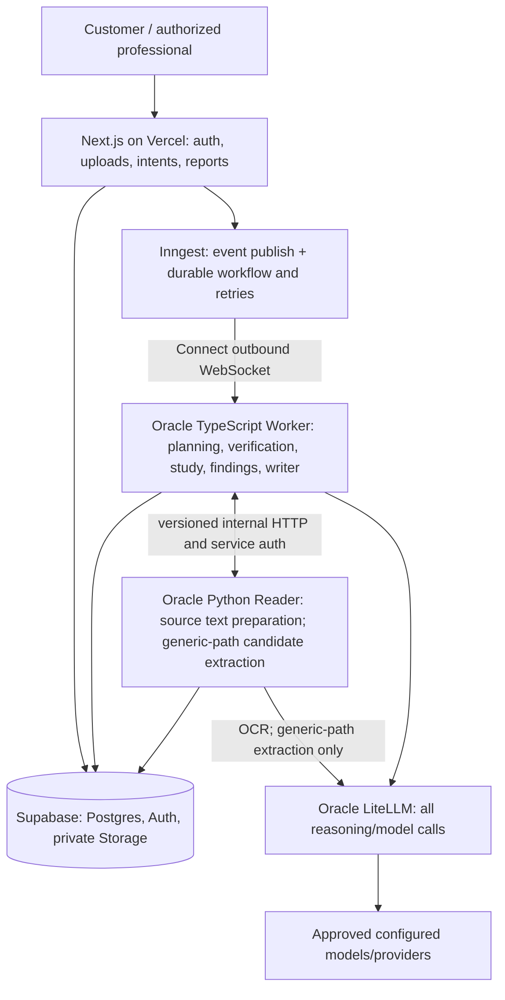

# HiveForYou V3 — System Architecture

**Version:** 1.0 | **Design approved:** 2026-10-22 | **Status:** Approved architecture baseline; implementation status tracked separately in `NEXT.md` and `DEVELOPMENT-PLAN.md`.

> **One Hive → one evolving Canonical Study → many intentions, defensible discoveries and customer/professional outputs.**

## 1. Authority, boundaries and terminology

This document defines **target behavior and architectural invariants**, not a claim that every feature is deployed. `PRODUCT-REQUIREMENTS.md` defines product outcomes; this file defines component responsibilities and trust boundaries; `REPOSITORY-STRUCTURE.md` defines code ownership; `DEVELOPMENT-PLAN.md` defines delivery gates; `NEXT.md` alone identifies the active ticket. `CURSOR-DEVELOPMENT-STANDARDS.md` and scoped `.cursor/rules/*.mdc` govern changes. The latest explicitly approved decision supersedes conflicting historical proposals; synchronize affected repository documents before implementing it.

A **Hive** is the access-controlled collection of source documents, intents and the evolving study about those sources. A **Canonical Study** is the single evolving, versioned representation of what can be established and investigated across the Hive. A **Domain Intelligence Pack** is an optional, reviewed, declarative specification of domain-specific document taxonomy, concepts, relationships, investigation mappings and communication guidance. A **snapshot** is an immutable view of accepted study state. A **claim** is an output statement requiring verified support or explicitly labeled derivation.

### Invariants

1. Domain-neutral execution: no hardcoded IEP, Medicaid, bankruptcy or grocery logic in universal Web, Worker, Reader or Core processing paths.
2. Optional packs: absent or unmatched pack never prevents generic extraction; selected *required* or pinned defective packs fail explicitly, not by silently pretending guidance was applied. **Selected-Pack extraction (P2.2-PX.D, proposed design):** when a reviewed pack is selected, it owns the document-type taxonomy and complete fact catalog, and the model extracts only catalog-defined facts — no model-generated schema on that path. The generic/no-Pack design is **deferred** (existing P2.2 implementation unchanged; pack-free grocery gate retained).
3. Source-first trust: models propose classifications, observations and interpretations (and extraction schemas on the generic path only); code validates evidence; authorized professionals/users may provide attributed corrections; no unverified candidate can enter accepted source-derived study facts.
4. Single logical Canonical Study per Hive, with immutable revisions and preserved contradictory/obsolete evidence; never destructive overwrite.
5. Every factual narrative statement cites verified observations, or a derived finding whose inputs and algorithm are traceable. Regulatory guidance and pack examples are **not** source evidence about the customer.
6. One durable processing path: Next.js/Vercel → Inngest → Oracle TypeScript Worker ↔ Oracle Python Reader → Oracle LiteLLM for every model call; Supabase for auth/private storage/Postgres. No shadow engines or direct provider fallback.
7. Independent intent and audience: an intent controls what to investigate; an audience controls presentation and authorized detail, not what the original documents said.
8. Production safety: owner/Hive boundaries, private sources, approved sensitive-data routing, idempotent effects, bounded calls, sanitized observability and explicit terminal failure states.

## 2. Product capabilities and the theory of intelligence

Traditional extraction answers **what fields appear**. HiveForYou must answer **what the records establish, what they contradict, how they changed, what remains unproven, and what question would clarify a material gap**. Intelligence is implemented as three different, never-conflated layers:

- **Observed:** source-derived candidate → independently verified observation, with source/document/page/quote and preserved modality.
- **Reconciled:** typed entities, records, events, measurements, assertions, relationships and timelines, preserving competing positions and uncertainties.
- **Derived:** deterministic or explicitly validated investigations (comparison, aggregation, conflict/gap/flow/change), carrying input assertions, operator version, assumptions, coverage and status.

The product must never infer “not performed” from “not documented in supplied records,” claim eligibility/legal violation from a discrepancy alone, treat purchase as consumption, or compare incompatible units/instruments without qualification.

## 3. Deployment and execution topology

Inngest owns workflow retry scheduling; individual Worker/Reader calls have deadlines and do not independently create nested retry trees. Vercel publishes study-run events; the **`hive3-process-study-run`** function registers on Oracle through **Inngest Connect** (no inbound Oracle URL or Worker token on Vercel). Inngest events carry IDs and stage handles, not raw sensitive source text. Worker is the single database and canonical acceptance owner. Reader does not merge studies, make authoritative cross-document identity decisions or directly promote facts.

### Stage contract (logical; not necessarily individual deployed endpoints)

| Stage | Owner | Inputs → outputs | Trust / durable effect |
|---|---|---|---|
| Upload/register | Web + Supabase | Authorized files → immutable source metadata, hash, private storage path | Tenant/Hive boundary; no inference |
| Plan questions (`P2.2-DP.I`; design `P2.2-DP.D`) | Worker | Verbatim intent (private store), optional pinned pack catalog → frozen **`study-question-set@1`** | One bounded LiteLLM proposal + deterministic equivalence; membership frozen before classify (**`UNIFIED-QUESTION-PLANNING.md`**) |
| Plan coverage / compile plan | Worker | Frozen question set, prior snapshot, sources → **`study-plan@1`** (reuse, investigation schedule, budget) | Reuse verified facts/findings first; prerequisite refresh after classify does **not** mutate question set |
| Read (`P2.1`) | Reader | Authorized source + hash → page/read artifact, quality, fingerprint | Untrusted rendered/OCR text |
| Classify/match/schema (`P2.2`, generic path) | Worker | Read artifacts, intent ref, optional reviewed pack pin → document candidates and bounded extraction schema | Proposed classification, pack version/digest; ambiguity retained |
| Extract candidates (`P2.2`, generic path) | Reader | Pages + validated schema → typed candidate records, source/page/quote anchors | Candidates **unverified** |
| Selected-Pack compile (`P2.2-PX`, proposed; stage `plan_schema`) | Worker + Core | Validated pinned pack → canonical system prompt, `prompt_digest`, stored once per digest | Deterministic; no model call; no intent or document text |
| Selected-Pack classify + extract (`P2.2-PX`, proposed; stage `extract`) | Worker → LiteLLM | Compiled prompt + Reader pages → `pack-extraction-output@1`, fact-level validation, `extraction_batches` | Catalog-defined facts only; candidates **unverified**; Reader does text preparation only |
| Verify (`P2.3`) | Worker | Candidates + independent source/read evidence → verified/rejected/unresolved dispositions | Trust promotion occurs here only |
| Reconcile (`P3`) | Worker | Verified observations + accepted prior study → new proposed study snapshot | Atomically advance current pointer only on success |
| Investigate (`P3.I`) | Worker/Core | **`study-plan@1`** + pinned snapshot → findings, gaps; emit **`study-question-coverage@1`** | Derived ≠ observed; `run_key` dedupe; budget deferral explicit |
| Compose (`P4`) | Worker writer | Pinned snapshot + findings + coverage + audience/report definition → customer/pro output | Every factual statement anchored, access checked |

**Read-before-plan resolution:** Question planning (`plan_questions`) runs on intent and catalog **before** classification fixes document types; **schema planning and reads** follow the frozen question set. Classification requires grounded page content — reads are preparatory substeps before extract, not a substitute for early intent capture. Persist stage ordering and idempotent artifacts on **`study_runs`** (and approved artifact storage from **P1.P**); Worker ephemeral buffers are not a second product pipeline.

**Persistence status (verified 2026-10-22):** M1 SQL persists Hives and registered sources only. **`study_runs`**, private intent storage, and versioned planning artifacts are **designed** (`docs/HIVEFORYOU-V3-DATABASE-DESIGN-v0.1.md`, **`UNIFIED-QUESTION-PLANNING.md` §10**) and **not implemented** in applied migrations — see **`DEVELOPMENT-PLAN.md` §3** for ticket gates.

## 4. Model and data contracts

Model calls are routed **only** through the Oracle LiteLLM gateway. Roles/aliases are configured centrally and versioned as runtime configuration; separate prompts may share the same role alias. P2.1 OCR alias and P2.2 reasoning aliases are known local designs. Lack of a configured alias is a diagnosed failure, never a direct-provider fallback. Protect prompts/source content from logs, enforce context/page coverage bounds, use structured JSON outputs, version contracts, and validate size/types/refs independently of model output.

**Selected-Pack prompt architecture (P2.2-PX.D, proposed):** one versioned, byte-stable system prompt per pack version + template + output contract, compiled deterministically from validated pack data (JCS canonical JSON, `prompt_digest`), carrying universal Hive extraction rules, document types, classification rules, the complete fact catalog, evidence/missing-value rules and the output contract. Document pages and source metadata travel only in the user message; intent is excluded. Provider prompt caching of the system prefix is an optimization configured at the LiteLLM routing boundary and must never affect correctness; provider capabilities are **unverified**. Large packs use bounded, completeness-proven partitions only when necessary. Detail: `docs/design/p2.2-px/PACK-EXTRACTION-PROMPT-ARCHITECTURE.md`.

**Current accepted local contracts (reported):** `reader-document-read@1`, `domain-pack-manifest@1`/`@2` (repo), `document-classification@1`, `extraction-schema@1`, `reader-candidate-extraction@1`, `reader-extract-candidates@1`, and `error-envelope@1`. **Proposed (P2.2-DP.D / P1.P; not deployed):** `study-question-set@1`, `study-plan@1`, `study-question-coverage@1`, verification dispositions, canonical assertions, findings, operator declarations, and audience projections. Contract types land in **`packages/contracts` at P2.2-DP.I**; durable storage lands at **P1.P Gate 2**. Avoid breaking existing contracts implicitly. Prefer explicit new contract versions for incompatible structures.

## 5. Evidence and epistemic integrity

| Logical object | Required semantics | Promotion guard |
|---|---|---|
| Source document | Immutable content ID/hash, Hive, source status, privacy ownership | Storage/authorization verified |
| Page artifact | Page index/text, extraction method, read fingerprint, quality flags | Rendering is not infallible |
| Candidate observation | Typed value, source ID, page, exact quoted text or supported location, schema/run, modality, uncertainty | Untrusted |
| Verification disposition | `VERIFIED`, `REJECTED` or `UNRESOLVED`; reason, verifier version, tested source fingerprint | Quote/page match **plus** actual value support; OCR ambiguity unresolved |
| Accepted observation | Candidate with verified anchors, source status and provenance | Eligible for study, not domain/legal verdict |
| Assertion | Subject/predicate/object or structured record, claimant/party, source attribution, effective and report dates, competing assertions | Must retain conflicts and origins |
| Relationship | Typed link, linked IDs, match method, evidence/derivation and confidence | Uncertain match never silently forced |
| Derived finding | Operator ID/version, input assertion IDs, output, parameters, coverage, assumptions and status | All necessary input edges traceable |
| Narrative claim | Snapshot, verified support and/or finding IDs, caveats and audience | Unsupported sentences rejected or rephrased as questions |

**Quote verification:** Normalize only under a documented, reproducible policy; verify source identity and page ownership before quote location; never reconstruct or fabricate quotation text. A located quote may still fail to support the associated value; this needs deterministic checks where feasible and `UNRESOLVED` where semantic support cannot be established. P2.3 is the authority for evidence checks; optional specialized semantic checks can be later separately approved.

**Negative knowledge:** `not_found_in_reviewed_scope`, `unreadable`, `uncertain`, `not_applicable`, and `conflicting` are different states. Coverage determines what can safely be called “not found.” Do not generalize absence in an incomplete collection.

## 6. The Canonical Study: relational-backed semantic graph

Use Supabase PostgreSQL; no mandatory graph database. These are **logical**, not automatically approved SQL tables:

- **Identity/records:** Entity, Record, Evidence-linked Observation, Event, Measurement, Relationship, Assertion.
- **State/history:** Hive, Study, StudyRun, StudySnapshot, Change/Conflict, ExtractionSchema, Batch, CoverageResult.
- **Intelligence/output:** Intent, Investigation, DerivedFinding, Question, ReportDefinition, GeneratedReport, AudienceAccess.

The existing V3 database design and migrations remain the authority for actual table names, RLS and columns until separately approved changes are applied. Versioned snapshot persistence and atomic pointer advancement prevent failed processing from corrupting the accepted study. No separate study per intent/persona.

**Identity:** Internal immutable IDs are separate from document-local labels/model-generated IDs. Match candidates use pack-provided content keys or generic semantic similarity, corroborating anchors and uncertainty; avoid merging similar but distinct goals, service rows, accounts, products and people.

**Time:** Source document date, event date, measurement date, valid-from/to, decision/effective date, recorded/processing date and asserted-as-of date remain distinct. Later date alone does not imply authority.

**Modality/roles:** Distinguish `planned`, `proposed`, `reported`, `observed`, `decided`, `delivered`, `amended`, `derived`, and `unknown`; track document author/party and attribution.

**Measurements:** Value, unit, denominator, instrument, population/conditions, method and timestamp; incompatible measures produce `UNRESOLVED`, not misleading arithmetic.

**Evolution:** New upload/intent creates a new `study_run_id`; successful extraction/verification extends the same study. Unchanged verified facts may be reused with a coverage proof; new intent-specific facts are appended or new interpretations derived. Existing accepted outputs and snapshots remain inspectable.

## 7. Universal Domain Intelligence Pack specification

Packs are **optional, declarative, reviewed and version-pinned**. They improve understanding but **never replace evidence**. Conceptual pack sections:

1. **Discovery:** Domain ID, reviewed safe pill metadata and starter intents; document types, title/header/body/negative signals and ambiguity policy.
2. **Concepts:** Typed record/item schemas, required/optional attributes, units and shared constructs, reusable fields, reading notes, source/temporal modalities and identity semantics.
3. **Relationships:** Allowed typed links, cardinality, compatible joining attributes, record identity keys and amendment/lineage guidance.
4. **Investigations:** References to allowlisted **generic** operators, input concept bindings, preconditions and safe outcomes (including insufficient-evidence behavior); execution is **not** part of pack work by default.
5. **Communication:** Domain terminology, customer/professional explanation hints and disclaimers that cannot weaken claim-checking or authorization.

A separate optional **regulatory overlay** can hold authoritative citations, jurisdiction and effective dates, review/version status and user-facing clarifications. It must not supply case facts or execute legal eligibility/adjudication logic as part of extraction. Authoritative source maintenance and effective-date rules need independent qualification.

**Content and release:** Domain Pack ID/version and immutable digest are pinned to each run. Preserve `@1` compatibility; introduce an explicit new manifest contract for incompatible nested records/sections. Reject collisions, schema references to nonexistent fields, unsafe operator names, cycles when invalid, oversize nested structures and unreviewed production packs. Keep `review_status` separate from semver; do not auto-upgrade old study runs. Distinguish selected/required pack failure from no optional match. Do not swallow corruption of a reviewed catalog silently.

**UI:** Derive **domain-level** pills and starter intents from a safe reviewed public projection only; do not confuse domain pills with individual document-type chips. Web must not import private match schemas, regulatory rules or executable pack code. Domain selection is a hint, not proof of document identity.

**New domain contract:** Adding `domain-packs/<id>/<version>/...` and reviewed public metadata must require **zero domain-specific code changes** to Web/Worker/Reader/Core. Generic fallback remains functional even with no packs. Verify this with a disposable synthetic second pack.

### IEP reference pack (design intent, not current deployed implementation)

Qualify against actual L001: referral, evaluation plan, parent consent, psychoeducational evaluation, academic evaluation, speech-language evaluation, eligibility determination, initial IEP. Extend to progress, reevaluation, amendments, meeting notes, prior written notices, FBA/BIP and service records using verified V2 pack fields, not reconstructed field guesses. Core concepts include educational need, evaluation result, eligibility decision, IEP goal, baseline/target, progress observation, accommodation, service commitment, observed delivery, amendment/event and communication. Preserve record-oriented service/goal rows, content-based keys, person/author roles, dates and provenance; use reviewed V2 v0.3 as reference with exact field reconciliation.

## 8. Universal investigation operators and derived findings

The **operator catalog belongs to generic Core/Worker**, not individual packs. Operators are bounded, versioned, side-effect-free computations or carefully qualified comparisons over a pinned snapshot. P2.2 pack refinement may **define/validate declarations**; operator execution must have its own later authorized ticket.

| Operator | Evidence/compatibility preconditions | Safe conclusion |
|---|---|---|
| `compare_measurements` | Same record/construct, unit, denominator, method and meaningful times | Trend/target gap or unresolved |
| `compare_commitment_observation` | Commitment and independently documented activity, aligned periods | Compared scope, no inferred non-delivery |
| `detect_change` | Reliable record identity and effective change interval | Before/after with source and scope |
| `find_disagreement` | Comparable assertions same identity/period | Explicit conflicting source positions |
| `trace_flow` | Supported links between transactions/accounts/parties | Traceable path and unknown hops |
| `aggregate` | Normalized currencies/units, bounded set, declared coverage | Sum/group/trend with caveats |
| `identify_gap` | Required or expected evidence justified by intent/pack and scope | Missing within reviewed material only |

Each finding includes `finding_id`, operator/version, pinned study snapshot, selected input assertion IDs, normalized arguments, check results, result, caveats, status (`SUPPORTED_DERIVATION`, `UNRESOLVED`, `REJECTED`), and optional review requirement. Model-generated ideas may nominate investigations but do not directly promote findings or execute arbitrary pack-defined code. In pack-free cases, generic intent planning chooses the same operators.

## 9. Intent, persona and outputs

A user query produces an **intent plan** against the existing study snapshot: applicable concepts, verification/coverage needed, required investigation operators and missing source attributes. Answer from reusable accepted information first; only schedule incremental source reads/extractions for material gaps. Avoid unnecessary repeat OCR/extraction. Protect snapshot consistency during concurrent runs.

Personas are **presentations/access policies**, not separate truth stores. A customer receives accessible plain language; an authorized lawyer/pro receives richer source-by-source chronology and unresolved issues. Both derive from the same pinned assertions/findings; authorization must independently control who can see the Hive and what can be shared. Never label legal/regulatory outcomes as established without qualified authority; proposed issues are questions for professional review.

Reports must show source chips/document/page and appropriately brief quotes where allowed, calculation provenance, ambiguity, missing coverage, and actionable questions. Source-derived, derived and attributed human corrections must be visually distinguishable.

## 10. Security, reliability, failure recovery

- **Authentication/authorization:** Supabase tenant/Hive boundary for sources, DB/RLS, facts, relationships, findings, reports, correction rights and shared access. Private buckets and expiring scoped object access; internal service tokens fail closed.
- **Sensitive data:** Provider eligibility/consent and privacy decisions precede transmitting IEP/Medicaid records outside the approved boundary. No assumption that gateway routing by itself authorizes any provider.
- **Run semantics:** New user action is a new study run; delivery retries dedupe **that run**, never accidentally dedupe distinct user actions. Stages idempotent; dedupe source/candidate/snapshot effects. Preserve current accepted pointer on failure.
- **Errors:** Use `error-envelope@1` with stable categories including auth, invalid request, unavailable source/storage/model, model timeout/output invalid, evidence not verified, incomplete coverage, merge/storage uncertainty. Distinguish transient from terminal; Inngest owns retries.
- **Observability:** Propagate correlation ID, Hive/run/batch/source IDs across stages; record alias, version/digest, stage, duration, scope and safe failure reason. Never log source text, quotations, prompts, signed URLs, tokens or model output payloads.
- **Recovery:** Expose actionable failure state; avoid partially promoted observations and partial study pointer advancement; require investigation of unknown database write outcomes before retry.

## 11. Qualification gates and proving cases

1. **Connectivity:** Real authorized UI → Inngest → Oracle Worker → Reader → result/status, with failure/retry/permissions checks; mocked connectivity is not E2E qualification.
2. **IEP L001:** Selected-Pack extraction per `docs/acceptance/P2.2-PX-pack-extraction-L001.md` (no `generate_schema` / `supplement_schema`). All eight actual files accounted for; document identities, page anchors, value support, omissions, candidate dispositions and goal/service record associations audited. V2 168 accepted facts is **diagnostic**, not a target count.
3. **Canonical:** One Hive/one study; repeat intents and new uploads create retained revisions; current/historical/competing claims and temporal relationships accurate.
4. **Investigation:** Correct supported and unresolved findings for compatible goal measures, planning vs delivery, amendment changes, conflicts/gaps; no unsupported verdicts.
5. **Personas:** Customer and authorized professional reports from the same immutable snapshot, each claim traceable.
6. **Pack-free grocery (mandatory release gate; generic extraction design deferred, not waived):** 20 receipts → 30 receipts, same study; changing intent (junk-food purchases → organic purchases → comparable unit prices), evidenced classification or unknown, no purchase-to-consumption assumption.
7. **Cross-domain architecture:** Synthetic Medicaid transfer/application and grocery cases using the *same* generic operator/canonical contracts; Medicaid customer vs attorney outputs; no domain-specific code branch.
8. **Operational:** Security denial, model outage, invalid schema, corrupt pack, retry, duplicate event, interrupted run and storage errors produce diagnosable recovery without corrupting accepted study.

Synthetic dry-run scenarios support architectural reasoning only and **are not evidence that implemented pipelines passed these gates**.

## 12. Delivery status, dependencies and change control

**Reported locally on 2026-10-22:** P2.1 Reader committed `71365af`; P2.2 classify/match/schema/extract committed `f9c9bbb`; local Worker/contracts/Core tests and Reader non-DOCX paths passed, with two DOCX tests skipped on a host lacking LibreOffice (previous P2.1 full-suite qualification was reported on another configured host). Both commits were **not pushed** as of the supplied report. This status is **user/Cursor-reported**, not independently inspected in the unpushed repository.

**Not qualified (product / live):** **P1.5-processing live acceptance** (orchestration in repo; integrated browser proof deferred), **P1.P Gate 1 live acceptance** (repo SQL + Worker client implemented 2026-10-22; six persistence scenarios deferred — see `docs/acceptance/P1.P-gate1-processing-persistence.md`), **P1.P Gate 2 live acceptance** (planning artifact contracts + Worker persistence in repo 2026-10-22; eight scenarios deferred — see `docs/acceptance/P1.P-gate2-planning-artifacts.md`), **P1.P Gate 3** (study revisions pointer), live LiteLLM reasoning (P5.3), P2.3 verifier, P3 study merge, **P2.2-DP.I** question planning runtime, P3.I investigations, and P4 reports. **P2.2-DP.D** and **`UNIFIED-QUESTION-PLANNING.md`** are approved design only. Repo **P2.2-DP** pack/catalog work does not imply **P2.2-DP.I** completion.

**Implementation sequence (dependency summary):** P2.2-DP.D → P1.P Gate 1 → P1.5-processing → (P2.3 / P2.4 integrated) → P1.P Gate 2 → P2.2-DP.I → P3 + P3.I → P4/P5. Details and blockers: **`DEVELOPMENT-PLAN.md` §3**.

Newly approved architecture requires plan/NEXT sync, architecture-and-pack contract proposal/approval, scoped implementation, negative-path tests and end-to-end verification. Preserve unrelated git changes; no code, migration, model spend, commit, push or deployment by mere approval of this document.

## 13. Decisions and controlled open items

**Approved architectural choices:** universal evidence-backed study; optional declarative Domain Intelligence Packs; five sections (Discovery, Concepts, Relationships, Investigations, Communication); generic allowlisted operator catalog; relational-backed semantic graph; audience-separated outputs sharing one truth layer; Oracle LiteLLM only; one integrated workflow.

**Pending explicit design/implementation approval:** P2.2-PX selected-Pack extraction implementation (P2.2-PX.I), `PAYLOAD_TOO_LARGE` ADR, deployed LiteLLM caching capabilities; deferred generic/no-Pack extraction design; exact v2 pack schema and version; pack-to-public-catalog build/projection; typed investigation/finding contracts; precise verification and semantic support policy; transactional persistence schema and RLS; live model/provider privacy policy; collaboration/report sharing permissions; quotas/cost/performance; release and operational topology specifics. The development plan owns their gating order.
