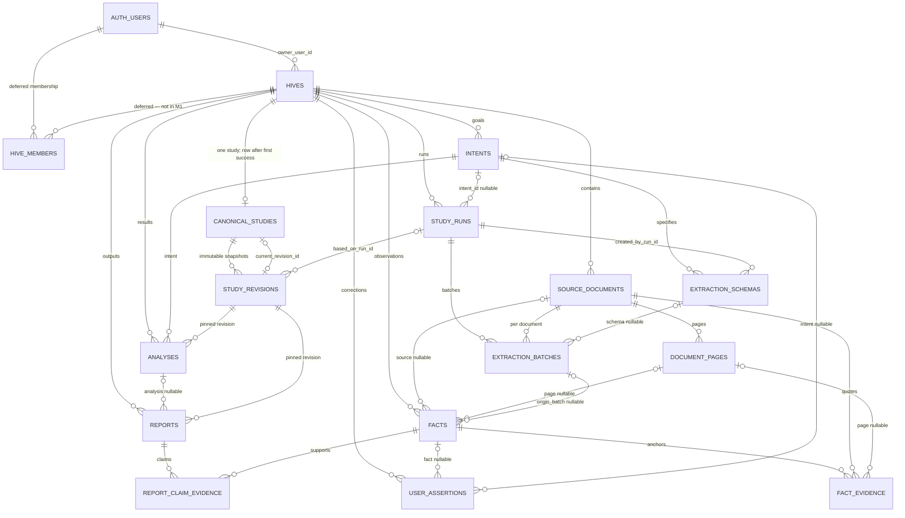

# HiveForYou V3 — Database inventory (P1.1)

**Ticket:** P1.1 — Database Schema Inventory  
**Status:** READY_FOR_REVIEW (2026-10-20)  
**Schema authority:** `docs/HIVEFORYOU-V3-DATABASE-DESIGN-v0.1.md` (table design still **proposed**)  
**Plan authority:** `docs/HIVEFORYOU-V3-DEVELOPMENT-PLAN-database-first-PROPOSED.md` (governing as of 2026-10-20; filename retained)  
**Requirements:** `docs/PRODUCT-REQUIREMENTS.md` §3.1 (MD-01–MD-05), §3.2 (OD-01, OD-02, OD-04–OD-07)  
**Recovery:** `docs/ERROR-HANDLING-RECOVERY.md` (approved P0.2)

This inventory does not approve SQL, change Supabase, or replace the v0.1 design. Proposed corrections at the end need a separate approval before P1.2 writes migration text.

## 1. Schema provenance

Three different objects must stay distinct. P1.1 inspected the repository only. It did not query Supabase, run SQL, or read a saved script of the SQL Editor session.

| Layer | What it is | P1.1 evidence |
|---|---|---|
| **Documented schema** | v0.1 design: 16 tables, conditional `hive_members`, private storage, RLS described in prose | File in repo. Not executed from this repo. `supabase/` has no migration files. |
| **Reported deployed schema** | User report in the P1.1 ticket (2026-10-20): SQL Editor created `hive3.hives`; owner-only **SELECT**, **INSERT**, and **UPDATE** policies; RLS **enabled** and **forced**. Cross-user isolation **not** tested. | User statement. The SQL text, column list, constraint list, grant list, and policy expressions are not in the repo. |
| **Independently verified schema** | Catalog query or two-user test whose output is stored as evidence | **None.** |

Treat the live table as an early manual object. It is not a migration baseline and it is not proof that Milestone 1 security is qualified.

## 2. Entity relationship diagram

Documented relationships, including foreign keys that §3 of the design names only inside column lists. `HIVE_MEMBERS` is conditional and is **out of Milestone 1** (MD-05). Storage buckets are not tables; see §5.

`AUTH_USERS` is `auth.users`, owned by Supabase Auth. Application tables live in schema `hive3`.

## 3. Scope by milestone

| Need | Entities |
|---|---|
| **Milestone 1** (auth, list, create Hive) | `auth.users` (platform), `hive3.hives` only. No `canonical_studies` row at create (MD-02). No `hive_members` (MD-05). No storage objects. |
| **Document upload** (after M1, before a study run) | `source_documents`, a private storage bucket, and a monthly successful-upload meter (OD-01). `document_pages` can wait until extraction. |
| **Study, evidence, outputs** | Remaining documented tables. First `canonical_studies` row and revision 1 are created together on the first **successful** study run. |

`hive_members` stays deferred until a sharing policy exists.

## 4. Entity inventory

Deployment for every row below is **documented only**, except `hives`, which is **reported deployed** and **not independently verified**.

Ownership for Milestone 1 is owner-only: `hives.owner_user_id = auth.uid()` under RLS. Child rows do not have their own owner column except where `uploaded_by` or `created_by` is listed. Their Hive scope is `hive_id`. Browser policies for child tables are not designed yet. `service_role` bypasses RLS; Worker checks are future code (P1.4/P1.5), not a database feature.

### 4.1 Ownership and intake

#### `hives` — workspace boundary

| | |
|---|---|
| **Keys** | `id uuid` PK. **`UNIQUE (owner_user_id, client_request_id)`** (MD-01). FK `owner_user_id → auth.users` **`ON DELETE CASCADE`** (OD-12; reported live action). Design also asks for an index on `owner_user_id` (the unique key already supports owner lookups as its left prefix). |
| **Columns** | Required: `owner_user_id`, `name`, `client_request_id`, `created_at`, `updated_at`. Optional: `description`, `archived_at`. |
| **Relationships** | One owner, many Hives. Parent of documents, intents, runs, facts, assertions, analyses, and reports. One Canonical Study when that row exists. |
| **Ownership** | The signed-in user may see and change only rows they own. Reported policies: SELECT, INSERT, UPDATE. No DELETE policy was reported. |
| **Lifecycle** | Insert as active (`archived_at` null). Update name, description, and `updated_at`. Archive by setting `archived_at`. Idempotent create: the same owner and `client_request_id` return the existing row (API behavior on the unique key). Owner hard-delete of one Hive stays unspecified; Milestone 1 grants no DELETE. Account deletion is OD-12 and is not a Milestone 1 job. |
| **When** | Milestone 1. |

Product limits that are not columns in v0.1: `name` 1–100 characters, `description` null or ≤ 500 characters (MD-01). `client_request_id` is a client-generated UUID stored as `text` in the design.

#### `hive_members` — conditional collaboration

| | |
|---|---|
| **Keys** | Composite PK `(hive_id, user_id)`. FK to `hives` and `auth.users`. `role` limited to `owner`, `editor`, `viewer`, `professional`. |
| **Relationships** | Many users per Hive, after sharing exists. |
| **Ownership** | Would widen RLS from `owner_user_id` to membership. |
| **Lifecycle** | Not created. Deferred (MD-05, design §6.1). |
| **When** | After Milestone 1, only with an approved sharing policy. |

#### `source_documents` — registered uploads

| | |
|---|---|
| **Keys** | `id uuid` PK. FK `hive_id → hives`. Unique `(hive_id, sha256)` is **open** (design §6; duplicate files may be legitimate). |
| **Columns** | `uploaded_by`, `filename`, `mime_type`, `byte_size`, `sha256`, `storage_path`, `status`, `created_at`, `deleted_at`. Initial MIME values: PDF, PNG, JPG, DOCX (OD-01). |
| **Relationships** | Many documents per Hive. Parent of pages, extraction batches, and evidence. |
| **Ownership** | Hive owner for M1. `uploaded_by` records the actor. Until sharing exists, `uploaded_by` should match the Hive owner. |
| **Lifecycle** | Register when private storage and the row are both committed. That registration is a **successful upload** for the Free quota (OD-01), independent of study success. Soft-delete via `deleted_at`. Status values are not enumerated. Whether a deleted file remains “eligible” for a full Study is open (requirements §6.1). |
| **When** | First document upload. Absent from the reported database. |

#### `document_pages` — evidence locators

| | |
|---|---|
| **Keys** | `id uuid` PK. FK `source_document_id`. **`UNIQUE (source_document_id, page_number)`**. |
| **Columns** | `page_number`, `text_storage_path` or bounded text (**open**, §6.3), `extraction_status`, `created_at`. No `hive_id` column. |
| **Relationships** | Many pages per document. Referenced by facts and fact evidence. |
| **Ownership** | Transitive through `source_documents.hive_id`. |
| **Lifecycle** | Created by extraction, not by the upload request itself. Rows are locators for quotes; replacement rules are unspecified. |
| **When** | Reader/evidence path (P2), not the upload write itself. |

#### `intents` — goals inside a Hive

| | |
|---|---|
| **Keys** | `id uuid` PK. FK `hive_id`. |
| **Columns** | `created_by`, `request_text`, `status`, `clarification_json jsonb`, `created_at`. |
| **Relationships** | Many intents per Hive. Parent of extraction schemas. Optional parent of runs, assertions, and analyses. |
| **Ownership** | Hive owner. |
| **Lifecycle** | Append a row per goal. Status values are not enumerated. Several intents may be active in one Hive. |
| **When** | First study/intent. Not Milestone 1. |

### 4.2 Study processing

#### `study_runs` — one row per intentional action

| | |
|---|---|
| **Keys** | `id uuid` PK (`study_run_id`). FK `hive_id`. FK `intent_id` **nullable**. **`UNIQUE (idempotency_key)`** for **delivery** dedupe only (P0.2). Multiple null keys must remain allowed. **Do not** unique `(hive_id, intent_id)`. |
| **Columns** | `status`, `stage`, `trigger`, `idempotency_key`, `correlation_id`, `started_at`, `finished_at`, `error_code`, `error_message_safe`, `model_alias`, `pack_version` nullable. |
| **Missing from the §2 column list** | Coverage scope and outcome. Design §4 and OD-07 require the run plan (full Study vs targeted reprocess) to be stored, for example `request_json` or a plan artifact. That column is not in the §2 list. |
| **Checks** | `status`: `QUEUED`, `RUNNING`, `SUCCEEDED`, `FAILED`, `CANCELLED`. `stage`: `enqueue`, `load_sources`, `plan_schema`, `extract`, `verify`, `merge_study`, `analyze`, `report`, `finalize`. Store sanitized errors only. |
| **Relationships** | Many runs per Hive. Parent of batches and of schemas those runs create. Optional `based_on_run_id` on revisions. |
| **Ownership** | Hive owner for browser reads. Worker writes with service-role and a server-side Hive check. |
| **Lifecycle** | Every Generate, Reprocess, or Study action inserts a **new** id. Duplicate delivery of that same enqueue hits `idempotency_key` and must not repeat committed work. Failure does not block a later new run and does not move `current_revision_id`. Concurrent runs per Hive are undecided (P1.3/P1.5). |
| **When** | First processing integration (P1.5+). |

#### `extraction_schemas` — generated specification, no registry

| | |
|---|---|
| **Keys** | `id uuid` PK. FKs `hive_id`, `intent_id`, `created_by_run_id`. |
| **Columns** | `schema_json jsonb`, `schema_hash`, `created_at`. Immutable row. |
| **Relationships** | Many schemas per intent. Optional parent of batches. |
| **Ownership** | Hive of the intent. |
| **Lifecycle** | Insert only. A changed specification is a new row. No uniqueness on `(intent_id, schema_hash)` yet, so identical schemas can repeat. |
| **When** | P2. Not Milestone 1 or the upload write. |

#### `extraction_batches` — one Reader call

| | |
|---|---|
| **Keys** | `id uuid` PK. FKs `study_run_id`, `source_document_id`, `extraction_schema_id` **nullable**. Design unique key: `(study_run_id, source_document_id, extraction_schema_id)`. |
| **Columns** | `status`, `raw_artifact_path`, `validated_artifact_path`, `error_code`, `created_at`. |
| **Relationships** | Many batches per run and per document. Optional origin of facts. |
| **Ownership** | Hive of the run and of the document. Those two Hives must be the same (composite FK; not specified as SQL). |
| **Lifecycle** | Insert per document attempt. Retry of the same delivery updates or conflicts on the unique key. Failed-run artifacts stay private under a retention policy whose **duration is open** (§6.5, OD-06). |
| **Constraint gap** | In PostgreSQL, a unique constraint treats nulls as distinct unless `NULLS NOT DISTINCT` (PostgreSQL 15). A null `extraction_schema_id` would **not** stop duplicate batches for the same run and document. |
| **When** | Extraction (P2 / P1.5). |

#### `canonical_studies` — one logical study per Hive

| | |
|---|---|
| **Keys** | `id uuid` PK. **`hive_id uuid UNIQUE`** FK to `hives`. `current_revision_id uuid` nullable FK to `study_revisions`. |
| **Relationships** | Zero or one row per Hive. Parent of revisions. Pointer names the current revision. |
| **Ownership** | Hive owner. |
| **Lifecycle** | **No row at Hive create** (MD-02). On first successful merge, insert the study and revision 1 in **one transaction**, then set `current_revision_id`. Later successes append a revision and move the pointer in that same transaction. Failed runs leave the pointer. Reconcile an unknown commit only by `study_revisions.based_on_run_id = study_run_id` (P0.2). |
| **Constraint gap** | Circular FK with `study_revisions`. Nullable pointer allows a committed study with no current revision unless a deferred check forbids that at commit. |
| **When** | First successful study run. Not Milestone 1. |

#### `study_revisions` — immutable snapshots

| | |
|---|---|
| **Keys** | `id uuid` PK. FK `canonical_study_id`. **`UNIQUE (canonical_study_id, revision_number)`**. FK `based_on_run_id` nullable. |
| **Columns** | `revision_number`, `snapshot_json` **or** `snapshot_storage_path` (one, §6.4 open), `created_at`, `created_by`. |
| **Relationships** | Many revisions per study. Referenced by analyses and reports. |
| **Ownership** | Hive of the study. |
| **Lifecycle** | Insert only. Never overwrite snapshot bytes. Numbers increase by one. Reports keep their pinned revision after later merges. |
| **When** | With the first successful study, then every successful merge. |

### 4.3 Evidence and correction

#### `facts` — reusable observations and labeled interpretations

| | |
|---|---|
| **Keys** | `id uuid` PK. FK `hive_id`. Nullable FKs: `source_document_id`, `document_page_id`, `origin_batch_id`. |
| **Columns** | `kind` (`observed`, `classification`, `derived`), `subject_key`, `predicate`, `value_json`, `confidence` nullable, `verification_status`, `created_at`. |
| **Relationships** | Many facts per Hive. Parent of evidence anchors and of report-claim links. Optional target of user assertions. |
| **Ownership** | Hive. A fact’s document, page, and batch must belong to that same Hive. |
| **Lifecycle** | Verifier-passed facts may be kept for reuse, including after a failed run (OD-06). **Unverified facts from a failed run are not merged** into the Canonical Study. Interpretation is not source truth. Identity rule (normalized rows vs snapshot-only) is open (§6.2). |
| **When** | P2/P3. |

#### `fact_evidence` — quote and page anchors

| | |
|---|---|
| **Keys** | `id uuid` PK. FKs `fact_id`, `source_document_id`. Nullable FK `document_page_id`. |
| **Columns** | `page_number`, `exact_quote` nullable, `location_json` nullable, `verification_status`, `created_at`. No `hive_id`. |
| **Relationships** | Many anchors per fact. Page may be absent for unpaginated files (§6.8). |
| **Ownership** | Transitive. Fact and document must share a Hive. |
| **Lifecycle** | Source-backed verified facts require an anchor through the verification workflow. Rows are evidence history, not editable quotes. |
| **When** | P2/P3. |

#### `user_assertions` — corrections that keep the original fact

| | |
|---|---|
| **Keys** | `id uuid` PK. FK `hive_id`. Nullable FKs `fact_id`, `intent_id`. |
| **Columns** | `created_by`, `scope` (`hive` or `intent`), `assertion_json`, `reason` nullable, `created_at`, `retracted_at`. |
| **Relationships** | Many assertions per Hive. A new study revision materializes the effective classification. |
| **Ownership** | The author is `created_by`; the Hive owner controls the workspace in M1. |
| **Lifecycle** | Append-only meaning. Retract by setting `retracted_at` or by appending a later assertion. Do not rewrite the source fact. |
| **When** | P3. |

### 4.4 Analyses and outputs

#### `analyses` — intent result pinned to a revision

| | |
|---|---|
| **Keys** | `id uuid` PK. FKs `hive_id`, `intent_id`, `study_revision_id`. |
| **Columns** | `created_by`, `result_json` or private artifact (§6.4 open), `status`, `created_at`. |
| **Relationships** | Many analyses per Hive and per revision. Optional parent of reports. |
| **Ownership** | Hive owner. |
| **Lifecycle** | A new result is a new row pinned to the revision that produced it. Later revisions do not rewrite it. |
| **When** | P4. |

#### `reports` — customer or professional output

| | |
|---|---|
| **Keys** | `id uuid` PK. FKs `hive_id`, `study_revision_id`. Nullable FK `analysis_id`. |
| **Columns** | `audience` (`customer`, `professional`), `request_json`, `created_by`, `status`, `output_storage_path` nullable, `created_at`. |
| **Relationships** | Many reports per Hive and revision. Claims link to facts through `report_claim_evidence`. |
| **Ownership** | Hive owner until sharing exists. Professional audience does not by itself grant another user access (OD-04 is about content, not membership). |
| **Lifecycle** | Independent historical runs. A report stays pinned to its revision. Supported factual claims need provenance (OD-04). |
| **When** | P4. |

#### `report_claim_evidence` — claim-to-fact links

| | |
|---|---|
| **Keys** | Composite PK `(report_id, claim_id, fact_id)`. FKs `report_id`, `fact_id`. `claim_id text` is not its own table. |
| **Relationships** | Many facts per report. Many reports may cite one fact. |
| **Ownership** | Report and fact must share a Hive. |
| **Lifecycle** | Insert with the report. There is no claims table; claim ids live in the report artifact. Regenerating a report with new claim ids would orphan links unless ids are stable. |
| **When** | P4. |

### 4.5 Platform objects that are not `hive3` tables

| Object | Keys / boundary | Lifecycle | When |
|---|---|---|---|
| `auth.users` | Supabase Auth primary key. Application does not copy a users table. | Register, session, email confirmation per environment (MD-04). OD-12: owned Hives cascade when this row is removed after the 30-day recovery window. The deletion job is a future ticket. | Milestone 1 auth. |
| Private storage | One or more **private** buckets. Object names scoped by owner and Hive. Paths stored on documents, batches, revisions, and reports. Bucket **names are not approved**. | Upload commits object + `source_documents` together. Failed-run artifacts retained only under an approved duration (§6.5). No public buckets. | Document upload and later artifacts. **No bucket is documented as deployed.** |
| Upload meter | **Not in the 16-table design.** OD-01: Free plan, **10 successful uploads per UTC calendar month across all Hives of the user**. Requirements put the exact columns at P1.2+. | A successful registration counts even if the study never runs. Soft-delete or hard-delete of a document must not erase the month’s count if the product rule is “successful registration”. | Before upload is enabled. See PC-08. |

## 5. `hive3.hives` drift assessment

| Item | Documented v0.1 | Reported deployed | Independently verified |
|---|---|---|---|
| Schema `hive3` | Required, isolated from V2 `hive` / `public` | Implied by `hive3.hives` | No |
| Table `hives` | Full column set in §4.1 | Exists | No |
| Columns and types | `uuid` / `text` / timestamps; nullability as in §4.1 | Not stated | No |
| `UNIQUE (owner_user_id, client_request_id)` | Required (MD-01) | Not stated | No |
| FK `owner_user_id → auth.users` | Required. **OD-12:** `ON DELETE CASCADE` | User (2026-10-20): `ON DELETE CASCADE`. P1.1 had not recorded the action. Q1 still required | No |
| Name / description length checks | Product rule; not written as SQL CHECK | Not stated | No |
| RLS enabled | Required (OD-02) | User confirms enabled | No |
| RLS **forced** | Design says enable RLS. It does not say `FORCE ROW LEVEL SECURITY` | User confirms forced | No |
| Policies | Owner isolation in prose | Owner-only SELECT, INSERT, UPDATE | Policy expressions, command list, and `TO` roles **not** in repo |
| DELETE policy | Unspecified. `archived_at` implies archive-by-update | Not reported | No |
| Grants (`USAGE`, table privileges, `anon` vs `authenticated`) | Not specified | Not stated | No |
| Data API exposure of schema `hive3` | Not specified | Not stated | No |
| `updated_at` maintenance | Column exists; no trigger | Not stated | No |
| Cross-user isolation | Required before M1 is qualified | **Not tested** (user) | No |
| Migration file | `supabase/migrations/20261020120000_hive3_m1_hives_baseline.sql` (P1.2, not applied) | Created in SQL Editor | Q1 catalog not yet diffed to file |

**Adopt from the report, after catalog proof:** forced RLS is stricter than the written design and should become the written standard (PC-01).

**Do not treat as aligned until a catalog snapshot says so:** columns, unique key, foreign key, checks, policy predicates (`USING` and `WITH CHECK`), policy roles, and grants. A policy named “owner select” can still omit `WITH CHECK` on insert/update. Without `WITH CHECK (owner_user_id = auth.uid())`, a client can insert a row owned by another user or move `owner_user_id` on update. That predicate is **unconfirmed**.

**Process drift:** the live table has no migration history, no rollback script, and no reviewed SQL in git. A later migration must **adopt** this object. It must not `DROP` it and it must not assume `CREATE TABLE` will succeed on an empty database only.

**Recovery:** SQL Editor work is unreproducible from this repo. `FORCE ROW LEVEL SECURITY` still does not apply to superuser or `BYPASSRLS` (`service_role`). Forcing RLS does not qualify the browser path. If the table owner is subject to the policies, a later repair session can lock itself out of maintenance updates unless a break-glass role is documented. No break-glass procedure is approved.

### 5.1 Migration reconciliation plan (drift → baseline)

The manual SQL Editor session is **migration drift**: live objects exist without a reviewed file under `supabase/`, without rollback notes, and without reproducible apply order. Reconciliation does **not** mean dropping or recreating `hive3.hives`.

| Step | Ticket | Action | Outcome |
|---|---|---|---|
| 1 | P1.3 prep (or approved read-only capture before P1.2) | Run **Q1** catalog SQL in Supabase; save sanitized output as ticket evidence (no credentials in git). | Known live definition: columns, constraints, policies, grants, API schema exposure. |
| 2 | **P1.2** | Author reviewed migration(s): `CREATE SCHEMA IF NOT EXISTS hive3`; **adopt** existing `hives` via `ALTER` / policy `CREATE OR REPLACE` / grant fixes only where catalog diffs from MD-01 and Q3; include repair and rollback notes. | Statically reviewable baseline SQL; PC-01–PC-12 decisions reflected or explicitly deferred. |
| 3 | **P1.2** | Record **adopt-not-drop** rule: migration must succeed on (a) empty `hive3` and (b) database that already has manual `hives`. Use idempotent DDL patterns; never `DROP TABLE hives`. | One migration story for fresh and drifted environments. |
| 4 | **P1.3** | Apply approved SQL to **non-production** only; run **Q2–Q5** and **Q4** two-user isolation. | Milestone 1 database gate qualified; cross-user isolation evidenced. |
| 5 | **P1.4+** | All further DDL only through `supabase/migrations/` (PC-12). | Drift closed; SQL Editor ad hoc changes forbidden. |

**Compare design vs executed SQL:** The executed script is **not in the repository**. Until Q1 runs, alignment is **unknown** for every structural and policy field in §5 except the user-reported presence of the table, three owner-oriented policies (SELECT/INSERT/UPDATE), and RLS enabled + forced. Any assumption that the manual script matched v0.1 §4.1 `hives` is **unsupported**.

## 6. Missing constraints and entities

### Milestone 1 (table may already exist; qualification does not)

Confirmed missing as **evidence**, even if the objects exist in Supabase:

1. Catalog proof of the MD-01 unique key, not-null columns, and `auth.users` foreign key.
2. Confirmed `WITH CHECK` on INSERT and UPDATE so `owner_user_id` cannot be chosen or reassigned.
3. Confirmed absence of a DELETE policy, or an explicit decision to allow owner delete (PC-04).
4. Confirmed privileges: `authenticated` can select/insert/update; `anon` cannot; schema `USAGE` is granted only as intended.
5. A two-user isolation test (still outstanding by the user’s report).
6. A decision on whether archived Hives appear in My Hives (no rule today).

Not missing for Milestone 1: `canonical_studies`, `hive_members`, storage, documents, runs.

### Document upload (all absent from the reported database)

1. `source_documents` and the private bucket, created and rolled forward together.
2. MIME allow-list and a configurable `byte_size` ceiling (OD-01, OD-05). The ceiling number stays implementation-time.
3. A meter for 10 successful uploads per user per UTC month **across Hives**. Counting current `source_documents` rows fails if delete removes the row that proved the upload. A dedicated append-only event is the proposal (PC-08), not an approved table.
4. Hive match for `uploaded_by` while access is owner-only.
5. Storage policies that match relational ownership. Bucket creation is a separate deliverable (design §4).
6. Eligible-document rule: rows with `deleted_at` set, and how they affect later full-Study coverage (requirements §6.1).

### Later study integrity (design names the rule; SQL shape is open)

1. Composite foreign keys so a row in Hive A cannot point at a document, page, fact, or revision in Hive B. Parents need `UNIQUE (hive_id, id)` for those FKs. `document_pages` and `fact_evidence` have no `hive_id` today, so the composite key has to go through the parent document or fact.
2. `study_runs` plan/coverage column missing from §2 (OD-07).
3. Deferred not-null on `canonical_studies.current_revision_id` at commit.
4. `NULLS NOT DISTINCT` on the extraction-batch unique key.
5. CHECK lists for statuses other than `study_runs`, which already has an approved list.
6. Snapshot storage choice (§6.4) before large JSON lands in a row.
7. `ON DELETE` from `auth.users` (restrict, cascade, or archive). Unspecified.
8. Retention duration and physical cleanup (§6.5).

### 6.4 Milestone 1 — minimum remaining prerequisites (database, API, authentication)

Implementation of Landing → Register/Login → My Hives → Create Hive stays blocked until the **database qualification gate** completes. Local Supabase env files (for example `apps/web/.env.local`, gitignored) are **configuration prep**, not schema or RLS evidence.

| Layer | Already decided (requirements) | Minimum still required before M1 UI can persist Hives safely | First ticket |
|---|---|---|---|
| **Database** | One `hive3.hives` row per create; MD-01 columns and unique key; MD-02 no study row; MD-05 owner-only; OD-02 RLS | Q1 catalog proof; Q2 structural match to §4.1; Q3 owner policies with confirmed `WITH CHECK`; Q4 cross-user isolation; Q5 grants + `hive3` Data API exposure decision; reviewed migration file adopting live table (§5.1, PC-12) | **P1.2** (SQL text) then **P1.3** (apply + test) |
| **Authentication** | Supabase Auth → `auth.users`; MD-04 `/auth/callback` + PKCE when email confirmation is on; session only in `apps/web` | Auth provider configured on shared Supabase project; redirect URLs and confirmation policy per environment; no auth secrets in git; browser uses publishable/anon key only | **P1.4** (with web bootstrap) |
| **API (web)** | List/create for authenticated owner; idempotent create on `(owner_user_id, client_request_id)`; post-create → `/hives/[hiveId]` (MD-03); no enqueue/status in M1 | `GET /api/hives`, `POST /api/hives` (adapt from V2 cases routes per reuse inventory), optional `GET /api/hives/[hiveId]` for shell; server sets `owner_user_id` from session (never trust client); stable error envelope (P0.2); Supabase client targets schema `hive3` | **P1.4** after **P1.3** |
| **RLS / permissions risk** | Owner isolation on `hives` | Unconfirmed `WITH CHECK`, grants, and cross-user tests (§5, §6.1 items 1–5) | **P1.3** |

**Not Milestone 1 database prerequisites:** `canonical_studies`, `hive_members`, storage buckets, `source_documents`, upload quota meter (PC-08), Worker/service-role write paths, Inngest enqueue.

## 7. Prioritized qualification checklist

Do not execute DDL from this list. Read-only catalog SQL is the evidence step. Two-user tests write only disposable rows in a non-production project and need a separate approval (P1.3). P1.1 did not run any of these.

### Q1 — Capture the live definition (blocker for P1.2 SQL)

Pass: a saved read-only result is in the ticket evidence, and a reviewer can diff it to §5.

Record `relrowsecurity`, `relforcerowsecurity`, column name/type/null/default, `pg_get_constraintdef` for every constraint, policy name/command/`USING`/`WITH CHECK`/roles, and `information_schema.role_table_grants` for `hive3.hives`. Also record schema `USAGE` grants and whether `hive3` is on the Data API exposed-schema list.

### Q2 — Milestone 1 structural match

Pass: the catalog shows PK `id`; not-null `owner_user_id`, `name`, `client_request_id`, `created_at`, `updated_at`; nullable `description` and `archived_at`; one FK `owner_user_id → auth.users` with **`ON DELETE CASCADE`** (OD-12); unique `(owner_user_id, client_request_id)`.

Fail closed into P1.2 review if any of those are absent. Do not add them in the SQL Editor ad hoc.

### Q3 — Owner policies

Pass, for role `authenticated`:

- SELECT `USING (owner_user_id = auth.uid())`
- INSERT `WITH CHECK (owner_user_id = auth.uid())`
- UPDATE `USING` and `WITH CHECK` both require `owner_user_id = auth.uid()`
- No DELETE policy, unless PC-04 is approved the other way
- RLS enabled and forced
- `anon` has no table privileges and no policy targeted at `anon`

### Q4 — Cross-user isolation (reported untested)

Pass with two non-production users, A and B:

- A inserts a Hive and reads it back.
- B’s select returns no row for A’s id.
- B’s update changes zero rows.
- B’s insert with `owner_user_id = A` is rejected.
- Replay of A’s `client_request_id` returns the original id and does not insert a second row.
- A name longer than 100 characters, or a description longer than 500, is rejected once those checks exist.
- `service_role` is not the browser key. Document that this role bypasses RLS.

### Q5 — Grants and API exposure

Pass: the browser role can use only the approved commands. Schema `hive3` is exposed on the Data API only when P1.4 is approved to call it. Exposure without Q3 and Q4 is a fail.

### Q6 — Upload gate (before any upload feature)

Pass: reviewed SQL exists for `source_documents`, private bucket policies, MIME/size checks, owner match on `uploaded_by`, and the quota meter; cross-user and cross-Hive storage reads fail; the 11th successful upload in a UTC month fails for the Free plan; a failed study does not increment or decrement that month’s upload count; deleting a document does not free the quota slot if PC-08 is accepted.

### Q7 — Study gate (P1.3 / P1.5, not M1)

Pass: one `canonical_studies` row per Hive; revision insert and pointer move commit together; a failed run leaves the pointer; duplicate `idempotency_key` does not create a second run; a new user action still can; a fact cannot reference another Hive’s document; snapshot rows are unchanged after a later merge.

### Q8 — Recovery and drift

Pass: the approved SQL lives under `supabase/` as the baseline, the manual `hives` object is adopted without drop, rollback notes exist, and a repeated apply is detectable. Fail if a second SQL Editor edit lands outside that file.

## 8. Proposed corrections (not approved, not applied)

| ID | Proposal | Why |
|---|---|---|
| **PC-01** | Write `ENABLE` and `FORCE ROW LEVEL SECURITY` into the design for every browser table. | Matches the reported `hives` posture and keeps the table owner inside RLS. Superuser and `BYPASSRLS` remain exceptions to document. |
| **PC-02** | Add CHECKs: `char_length(name) BETWEEN 1 AND 100`; `description IS NULL OR char_length(description) <= 500`; `char_length(btrim(client_request_id)) > 0`. | MD-01 limits are currently API-only in the design. |
| **PC-03** | Store `client_request_id` as `uuid`. | MD-01 says the client sends a UUID. v0.1 uses unbounded `text`. |
| **PC-04** | Milestone 1 has no DELETE policy and `DELETE` is revoked from `authenticated`. Archive uses `archived_at`. | Reported policies already omit DELETE. Product still needs an explicit archive-list rule. |
| **PC-05** | `id uuid PRIMARY KEY DEFAULT gen_random_uuid()`, timestamps `timestamptz`, `owner_user_id` default `auth.uid()` plus the `WITH CHECK` in Q3, `updated_at` trigger. | Defaults are unspecified. The unique idempotency key is `client_request_id`, so the client should not mint `id`. |
| **PC-06** | Historical proposal: `owner_user_id` FK `ON DELETE RESTRICT` until §6.5 defined account deletion. **Superseded 2026-10-20 (OD-12):** reported live action and the P1.2 migration keep `ON DELETE CASCADE`. Notification, 30-day retention, recovery, permanent cleanup, and deletion audit wait for a future ticket. Milestone 1 adds no deletion tables. | The live foreign key already cascades. `RESTRICT` would change that behavior on a clean install. |
| **PC-07** | Add the OD-07 run-plan column to the `study_runs` column list (`request_json` or a private plan path, plus coverage outcome). | §4 requires it; §2 omits it. |
| **PC-08** | Add append-only `upload_quota_events` (`id`, `owner_user_id`, `hive_id`, `source_document_id`, `created_at`) as the Free-tier meter. Do not recount by scanning deletable document rows. | OD-01 counts registrations per user per UTC month across Hives. This is a 17th relation, outside the current 16. |
| **PC-09** | Unique extraction batches with `NULLS NOT DISTINCT`. | Otherwise a null schema id does not dedupe retries. |
| **PC-10** | Deferrable constraint: `current_revision_id` is not null at commit. Keep the column nullable only so the study row and revision 1 can be inserted in one transaction. | MD-02 creates the study on success, together with a revision. |
| **PC-11** | P1.2 specifies composite `(hive_id, id)` foreign keys before any child table is created. | Design §4 requires cross-Hive integrity and does not give the SQL shape. |
| **PC-12** | Next SQL change is a reviewed migration that **adopts** live `hive3.hives`. No further SQL Editor DDL. | Closes process drift without dropping the live table. |

## 9. Decisions still open

Left open on purpose. Resolving them is the approval after this review, not a silent edit to v0.1.

| Topic | Where it already lives | Blocks |
|---|---|---|
| Document archive vs hard delete; failed-run artifact retention duration; physical storage cleanup during ordinary Hive use | Design §6.5, OD-06, requirements §6.1 | Later than M1 table presence. Account deletion itself is OD-12 (approved policy; future ticket) |
| Whether My Hives hides `archived_at` rows | Unspecified | M1 list behavior at P1.4 |
| `client_request_id` type `uuid` vs `text` | PC-03 | P1.2 `hives` SQL |
| Fact row vs snapshot as source of truth | Design §6.2 | P3, not M1 |
| Page text in-row vs object storage | Design §6.3 | P2 |
| Large snapshot / report / raw model JSON in JSONB vs storage | Design §6.4 | P1.5+ artifacts |
| Professional sharing and `hive_members` | MD-05, §6.1, §6.6 | After M1 |
| Duplicate `(hive_id, sha256)` | Design §2 `source_documents` | Upload SQL |
| Eligible documents for full Study | Requirements §6.1, OD-07 | P1.5 coverage |
| Concurrent runs per Hive | P0.2 deferred to P1.3/P1.5 | Study qualification |
| Data API exposure of `hive3` now vs at P1.4 | PC / Q5 | Any browser call |
| Bucket names and count | Design §4 “bucket(s)” | Upload SQL |
| Account-delete FK action | OD-12 (2026-10-20) | Resolved for schema: `ON DELETE CASCADE`. Processing is a future ticket, not P1.3 |

## 10. Next approval gate

1. Accept or amend this inventory (closes P1.1).
2. Accept or defer each PC-01–PC-12.
3. Only then start **P1.2**: reviewed SQL and RLS text, including an adopt-not-drop plan for the live `hives` table. P1.2 still does not execute migrations.
4. **P1.3** is the first ticket that may apply SQL to non-production, and only after that SQL is approved. Q4 cross-user tests belong there unless a narrower read-only catalog capture is approved earlier to finish Q1.

### Recommended next ticket: **P1.2 — SQL + RLS design** (precise scope)

| In scope for P1.2 | Out of scope (later tickets) |
|---|---|
| Initial `supabase/migrations/` baseline: `hive3` schema; **M1-only** `hives` table definition reconciled to Q1 catalog (adopt-not-drop) | `CREATE TABLE` for the other 15 design tables |
| Constraints: PK, MD-01 unique key, FK to `auth.users`, not-null set per §4.1; optional PC-02–PC-06 if accepted | Storage buckets and storage policies |
| RLS: ENABLE + FORCE; policies matching Q3; explicit DELETE revoke / no DELETE policy if PC-04 accepted | `upload_quota_events` (PC-08) unless PC-08 accepted in P1.2 |
| Grants: `authenticated` vs `anon`; schema `USAGE`; note required Data API exposure for `hive3` | Applying migration to any Supabase project (P1.3) |
| Rollback/repair notes; idempotent patterns for drifted vs empty DB; document any `ALTER`-only delta from manual create | P1.4 app routes, auth UI, or V2 port |
| Cross-reference PC decisions in migration comments or companion ADR snippet | P1.5 processing tables and Worker writes |

**P1.4 (repository bootstrap)** remains blocked until P1.3 qualifies the M1 database path; P1.4 then implements auth + Hive list/create against the qualified schema.
